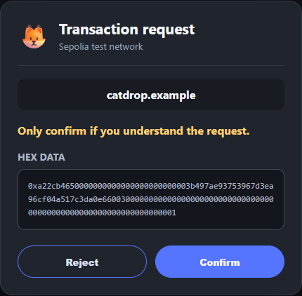
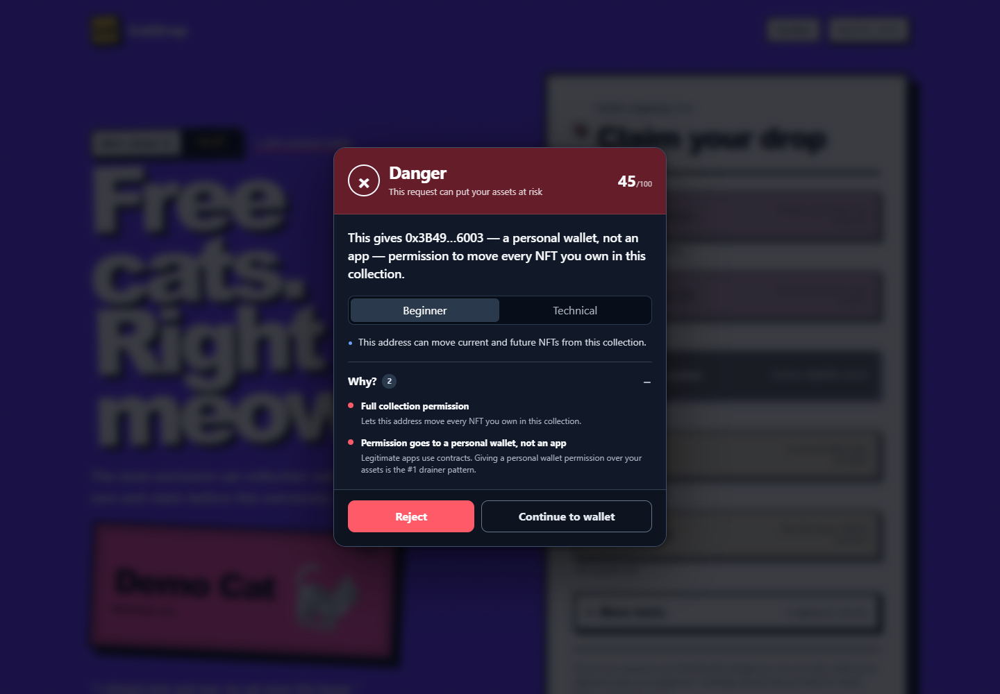
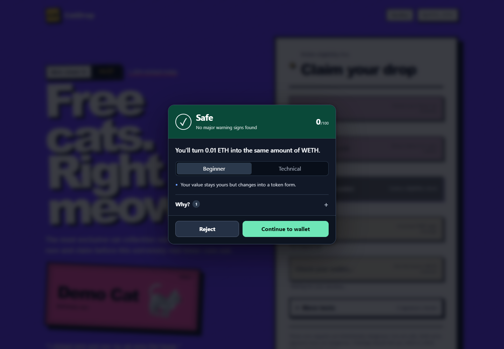
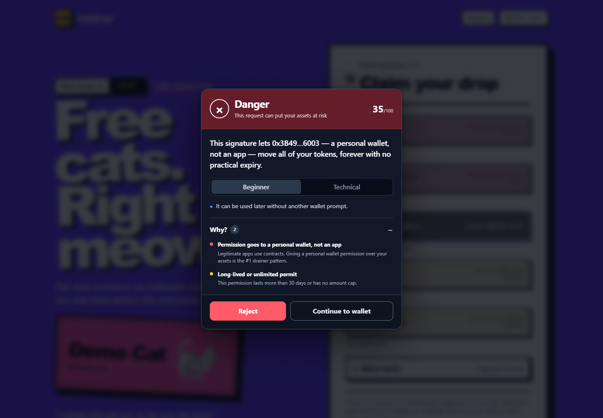

<!-- _class: title -->

Crypto World's Fair 2026 · Ethereum L1

# PlainSign

Understand wallet permissions before you sign them.

---

## Wallet prompts expose data, not consequences

A button says **Free Mint**.

The wallet shows raw hex and asks for confirmation.

The hidden request grants permission to move an entire NFT collection.

---

## A plain-English checkpoint before the wallet

**Danger** appears before MetaMask.

The sentence names the real permission and the address receiving it.

Reject stops the request with standard wallet error `4001`.

---

## Live demo

● ● ● ● ● ● ●

Seven requests cover disguised approvals, Permit2, SIWE, WETH, opaque hashes, and Seaport.

The card explains the consequence before the real wallet receives the request.

---

## Technology

  dApp <small>EIP-1193</small><b>›</b>
  Provider proxy <small>MV3 MAIN world</small><b>›</b>
  Decode and enrich <small>viem + public data</small><b>›</b>
  Open rules <small>deterministic JSON</small><b>›</b>
  Overlay <small>React + Shadow DOM</small>

Continue forwards the untouched request. Reject returns error 4001. Optional Sepolia simulation adds expected balance changes.

---

## Innovation

**Signature-first** 
Permit2 and marketplace orders count as asset-risk events.

**Meaning-first** 
The lead sentence describes what changes for the user.

**Open rules** 
Every score and reason is auditable in `rules.json`.

---

## Impact and honest limits

<h3>Earlier decision</h3>
Users see the consequence before the wallet confirmation.

<h3>Clear reasons</h3>
Each verdict lists the rule that fired and what could go wrong.

<h3>Local by design</h3>
No backend, account, paid dependency, analytics, or telemetry.

PlainSign provides heuristics, not guarantees. Chrome and MetaMask are the primary path. EIP-6963 support is best-effort. Signatures are decoded rather than simulated. Unknown requests receive Caution.

---

## New work for Crypto World's Fair

**Ethereum L1 support** 
Mainnet RPC, contract metadata, and network-specific protocol addresses.

**Warnings survive an RPC outage** 
Known-drainer evidence stays visible. Incomplete address checks receive Caution.

**A demo judges can open immediately** 
Five sample requests run through the shipped decoder and rules without a wallet.

Earlier work, including the interceptor, Revoke instead and drainer feed, is disclosed separately. Sample metadata is simulated. Mainnet verification reads public chain data only.

---

## A free extension with a paid integration path

**Free for individuals** 
Open rules and a local warning layer lower the cost of trying PlainSign.

**Proposed wallet and dApp SDK** 
Charge teams for integration support, maintained rule packages, and policy controls.

**Validate before pricing** 
Interview wallet builders and test whether teams will pay for easier integration.

Business model is a hypothesis. No revenue, customer, or adoption claims are made.

---

## Distribution starts with understandable evidence

**First users** 
Ethereum wallet users and community educators who can test deceptive approvals.

**First partners** 
Wallet and dApp teams that want an inspectable request-analysis module.

**Next validation milestone** 
Observe five users trying the demo. Measure correct explanations, false alarms, and completion time. Seek two SDK design partners.

These are planned experiments. The sample walkthrough and automated tests demonstrate functionality, not market traction.

---

## Team and the next milestone

**PlainSign** 
Open source at github.com/adib-cyber007/plainsign.

**Before submission** 
Add confirmed participant names, backgrounds and university affiliation.

**Next product milestone** 
Independent security review, observed user tests, then a wallet SDK pilot.

github.com/adib-cyber007/plainsign

